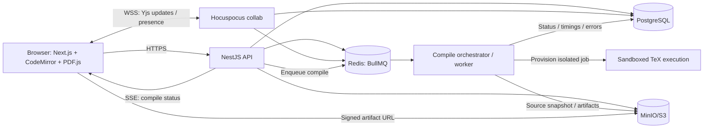

# Private LaTeX Cloud — Architecture & Delivery Blueprint

**Status:** Proposed architecture, 2026-11-01.  
**Purpose:** A private/self-hostable, multi-user LaTeX authoring platform for mathematics and computer science with premium-class editing, collaboration and fast PDF feedback.  
**Primary deployment:** Docker Compose for trusted development/pilot, production-target AWS design without wholesale rewrite.

## 0. Executive decisions

- Build an **independent product**, not a rebranded Overleaf CE fork. Do not copy its AGPL source without a deliberate licensing decision.
- Start as a **modular monolith** (NestJS API), **separate collaboration server** (Hocuspocus/Yjs), and **independent compile worker/control plane**. Do not split business domains into microservices on day one.
- Editor: Next.js + React + CodeMirror 6; Yjs v13 + stable `y-codemirror.next` binding (pin versions after compatibility tests); PDF.js renderer.
- Persistence: PostgreSQL metadata and durable collaboration state; S3-compatible object storage (MinIO locally; S3 on AWS); Redis for BullMQ and coordination.
- Compiler: version-pinned TeX Live image, `latexmk` orchestrating pdfLaTeX/XeLaTeX/LuaLaTeX, `biber`/BibTeX as needed. Use SyncTeX. Tectonic is an **optional engine experiment**, not a compatibility-preserving default.
- **Security gate:** internet-facing multi-tenant production is blocked until per-job/tenant isolation, no-egress policy, strict resource controls, file isolation and adversarial testing are complete. Docker Compose alone is an orchestrator, not a compile sandbox.
- **Unlimited features** does not mean unlimited resources; include configurable quotas and abuse prevention.

## 1. Product scope

### Users and roles
- Solo author, invited collaborator, project admin, organization admin, platform admin.
- Project ACL: owner / editor / viewer. Organization scope can be added later.
- Multiple users can log in, hold projects, and edit simultaneously; no feature-based subscription flags.

### Prioritized user journeys
1. Sign in -> create project from Math/CS template -> edit `main.tex` -> compile -> inspect PDF and errors -> download PDF/ZIP.
2. Import Overleaf-style ZIP or a folder with `.tex`, `.bib`, images -> choose root document and engine -> compile.
3. Invite another user -> concurrently edit a file -> see cursors/presence -> reconcile offline/reconnect -> compile a consistent revision.
4. Recover previous version -> inspect diff -> restore safely.
5. Add citations, figures, algorithm snippets and equations with smooth keyboard-first editing.

### Supported language/format capabilities
- LaTeX engines: pdfLaTeX, XeLaTeX, LuaLaTeX, version-pinned.
- Math: `amsmath`, `amssymb`, theorem/proof environments, `mathtools`, `tikz`, `pgfplots`, `physics` where supported.
- CS: `algorithm2e`, `algorithmicx`, `listings`, `hyperref`, `cleveref`, BibTeX/Biber, common conference/class templates under their own licenses.
- File types: `.tex`, `.bib`, `.sty`, `.cls`, `.txt`, image assets and PDF resources; arbitrary executables are never run.
- `.bib` should have basic syntax highlighting and search in MVP. Rich citation search and Zotero integration are later features.
- `minted` requires special handling: do not enable unrestricted `-shell-escape`. Support only after compatible, isolated, strictly reviewed configuration is ready.

### Explicit MVP non-goals
- WYSIWYG editor, AI writing assistant, full GitHub sync, track changes, enterprise SSO, custom executable/script execution, simultaneous arbitrary filesystem mounts, plugin marketplace.
- Do not promise faster compile than commercial Overleaf across all documents; benchmark on defined workloads.

## 2. High-level architecture



**Trust boundary:** web/API and collab are application services; TeX execution is **untrusted** and must run outside their trust domain. API must never expose Docker socket or pass secrets to compile sandbox.

### Service responsibilities
| Service | Responsibility | Scaling |
|---|---|---|
| `web` | Responsive UI, editor, document viewer, keyboard shortcuts | Stateless replicas |
| `api` | Auth/ACL, projects, file metadata, snapshots, job scheduling and status | Stateless replicas |
| `collab` | Yjs transport, presence, persistent text state and authorization | Redis-backed scale-out later |
| `compiler-orchestrator` | Fetch immutable snapshot, run isolated build, parse errors, publish artifacts and metrics | Replicas; project-aware fairness |
| `postgres` | Relational authoritative metadata, snapshots/updates, audit, job records | Managed RDS later |
| `redis` | BullMQ, ephemeral coordination and collab fan-out | ElastiCache later |
| `minio` | Blob storage for assets, PDFs and version exports | S3 later |
| `sandbox-executor` | Host/cluster-specific isolated compilation interface | gVisor/VM-type isolated jobs |

## 3. Proposed repository structure

```text
latex-cloud/
  apps/
    web/                    # Next.js app
    api/                    # NestJS modular monolith
    collab/                 # Hocuspocus / Yjs server
    compile-orchestrator/   # queue consumer / execution control
  packages/
    ui/                     # design system, themes, icons
    shared/                 # Zod schemas, API contracts, DTOs
    editor/                 # CodeMirror 6 config, Yjs binding, shortcuts
    compiler-protocol/      # engine config, job/artifact/events definitions
    tex-log-parser/         # .log diagnostics -> structured errors
  infra/
    compose/                # local compose, trusted-dev profiles
    tex-images/             # pinned TeX Live Dockerfiles, test fixtures
    aws/                    # IaC added later
    sandbox/                # sandbox driver and security policies
  tests/
    e2e/
    compile-fixtures/{basic,math,tikz,biber,xelatex,lualatex,cs,errors}/
    security/
    load/
  docs/
    architecture/ADRs/
    product/
  README.md
```

### Technology notes
- Choose stable `y-codemirror.next` with matching Yjs major release. Verify updated versions before install.
- Hocuspocus persists the **Yjs binary** state, not a JSON-converted recreation. Store text as a **derived/materialized** representation for compilation and ZIP export.
- Avoid mutable state in `web` and `api` local disks; local scratch files allowed only inside sandbox job workspace.
- Use typed API contracts, migrations, input validation, consistent error shape, request IDs and trace IDs from day one.

## 4. Canonical data model

Relational sketch (fields not exhaustive):

```text
users(id, email, display_name, auth_provider_id, created_at)
projects(id, owner_id, name, default_branch, root_file_id, engine, tex_image_version, created_at)
project_members(project_id, user_id, role, invited_at, accepted_at)
project_files(id, project_id, parent_id, path, kind[text|binary], ydoc_name, blob_key, deleted_at)
collab_documents(file_id, ydoc_state_binary, state_version, persisted_at)
collab_updates(id, file_id, sequence, update_binary, created_at)  # optional append log as required
project_revisions(id, project_id, content_manifest_key, root_file, engine, created_by, created_at, source_fingerprint)
compile_jobs(id, project_id, revision_id, status, requested_by, engine, queued_at, started_at, finished_at, duration_ms, error_code)
compile_artifacts(id, compile_job_id, kind[pdf|log|synctex|fls], blob_key, size_bytes, sha256)
project_audit_events(id, project_id, actor_id, action, metadata, created_at)
```

- Authoritative text content is Yjs state; file paths/permissions are relational; images/binary files are object-store keys.
- Define a **revision manifest** (hashes of all files + root file + engine + TeX image + allowed options). Each compile job references exactly one immutable revision; do not compile a partially live directory.
- Project file tree operations must be transactional at metadata level; cross-service changes need idempotency and recovery.
- Define conflict rules when a collaborator renames/deletes a file while another edits it; preservation over silent data loss.
- Collaboration durability: use snapshots + update log/flush policy. A debounce-only write risks losing recent edits on crash. Set an explicit acceptable data-loss RPO and test crash recovery; do not claim zero-loss without durability acknowledgments.
- Revision capture obtains a consistent, authorized project-wide snapshot; one file per Yjs room simplifies editor lifecycle. Prevent cross-file torn revisions with a coordinated snapshot barrier/versioning protocol.

## 5. Compile pipeline (core differentiator)

### Data flow
1. User presses Compile or debounced auto-compile fires; API validates `project:read` plus `compile` rights and resource quotas.
2. Capture/call for an **immutable project revision**. Compute content fingerprint based on all relevant files + engine/options + TeX image.
3. If an artifact for the same complete fingerprint already exists, return it immediately (cache hit) and record access.
4. Else enqueue job with project-level `keep latest` behavior; at most one active compile per project and one newer pending revision.
5. Orchestrator picks job fairly (per-user/per-project priority; global concurrency cap), hydrates source snapshot into isolated sandbox, reuses only safe project-specific intermediates.
6. Execute `latexmk` with selected TeX engine, `-synctex=1`, noninteractive flags and strict limits; parse diagnostics and save `.pdf`, `.log`, `.synctex.gz` and timing measurements.
7. Atomic publish artifacts keyed by job/revision, update status, emit SSE/WebSocket status; UI preserves the last successful PDF until a newer successful build arrives.
8. When a newer revision supersedes the job, mark old artifact as historical and **never** show it as up-to-date.

### Why `latexmk` first?
- It automates multiple passes, reference resolution and dependencies for common TeX Live documents.
- It can inspect `.fls`, `.log`, `.aux` and trigger only needed passes, giving practical wins for incremental builds.
- Tectonic is promising for alternative engine experiments and reproducibility but does not automatically replace full TeX Live compatibility.

### Performance strategy: layered
**P0:** keep compiler images and dependencies warm; no TeX Live install or network downloads on compile request.

**P0:** compile asynchronously; isolate workers from HTTP response deadlines; prefetch source and use local scratch SSD.

**P0:** deduplicate by immutable fingerprint, debounce auto-compile (e.g., 0.8–1.5s), implement per-project latest-wins queueing and stale-job handling.

**P1:** incremental per-project build workspaces, keyed by source/engine/TeX version; reuse `.aux`, `.toc`, `.bbl` cautiously, with correct invalidation and clear-cache fallbacks. Store inside tenant-isolated scratch/cache, never share writable cache across tenants.

**P1:** prioritized interactive queue with fairness to prevent one project from monopolizing CPU.

**P2:** benchmark engine variants/templated formats, prebuild optimized TeX formats, profile font and graphics bottlenecks, optionally test Tectonic behind feature flag.

### SLOs: aspirational, measured rather than guaranteed
- Editor typing response p95 < 50 ms on reference laptop.
- Browser sees `Queued` response p95 < 300 ms in standard-load test.
- Small warmed document cached/unchanged -> PDF response p95 < 500 ms **for cache hit**, excluding download throughput.
- Small warmed document changed -> compile completion target p50 < 3 s on specified worker hardware and fixture.
- Error diagnostics appear at correct file/line for a defined suite, ≥95% fixture coverage.
- Never overwrite last known good PDF with failing compilation output.
- Measure p50/p95 by first/cold/warm/cache-hit, engine, document class, worker type and queue wait; tune only after baselines exist.

## 6. Security and multi-tenancy — release blocker

**Critical:** TeX inputs can read/write files and sometimes launch subprocesses (`\\write18`/shell-escape). `-no-shell-escape` and non-root containers alone are not enough isolation for arbitrary strangers. Overleaf CE explicitly warns that unsandboxed compiles are inappropriate for untrusted multi-user production.

### Production threat model
- Malicious/buggy LaTeX, path traversal, package injection, fork/resource bombs, persistence attacks, file snooping, SSRF/network exfiltration, cross-tenant cache leakage, ZIP bombs, vulnerable image converters, too-large PDFs/logs, malicious uploaded file formats, stolen auth tokens.

### Enforced controls
- One isolated execution environment per job/tenant with strong isolation (gVisor `runsc`, microVM, or properly isolated AWS Fargate task); choose deployment-specific executor and test it.
- `read-only` base image; writable mounted work dir only; no host filesystem, Docker socket, IAM role credential endpoint or cloud metadata service.
- Run as unprivileged UID; drop Linux capabilities, `no-new-privileges`, seccomp/AppArmor where applicable; no privileged workloads.
- Network **denied from compiler sandbox by default**, including metadata, internal services and external destinations; preinstall/prefetch packages via trusted image build pipeline.
- Strict CPU, memory, pids, disk size, output byte limits, wall-clock timeout and execution concurrency; job cancellation and process-group cleanup.
- Validate canonical paths/symlinks, forbid escaping project root, inspect and bound ZIP extraction, prevent polyglot uploads and disallow executables.
- `-no-shell-escape` by default; carefully reviewed limited-mode exceptions only inside dedicated sandbox.
- Compiler cannot read DB, Redis, S3 credentials directly. Orchestrator handles storage; sandbox sees only input snapshot and output location/capability as necessary.
- Signed URLs: short lifetime, access-controlled issuing endpoint, upload bound to expected key/checksum/content constraints; serve PDFs with safe content disposition/CSP as appropriate.
- Project/organization ACL server-side on EVERY API/WS/job/artifact path; add abuse/rate limits/audit logs and security regression tests.
- Backups, restore drills, patch cadence, dependency scan, SBOM, image signatures/scans, secrets management.

### Deployment modes
- **Trusted local pilot:** Compose starts application + Postgres + Redis + MinIO + isolated worker adapter. Any weaker sandbox may only be used on localhost with exclusively trusted documents, never exposed as production.
- **Untrusted-user production:** no launch until compiled-job sandbox architecture is threat-modelled, tested and validated. Favor sandbox gVisor or microVM per job, no cross-user writable state.

## 7. API contracts (initial)

Use REST for business resources + SSE for compile stream; WSS for Yjs collaboration.

```http
POST   /api/v1/projects
GET    /api/v1/projects
GET    /api/v1/projects/{projectId}
PATCH  /api/v1/projects/{projectId}
POST   /api/v1/projects/{projectId}/files
POST   /api/v1/projects/{projectId}/imports
GET    /api/v1/projects/{projectId}/files
POST   /api/v1/projects/{projectId}/revisions
GET    /api/v1/projects/{projectId}/revisions
POST   /api/v1/projects/{projectId}/compiles
GET    /api/v1/compiles/{jobId}
GET    /api/v1/compiles/{jobId}/events     # SSE
GET    /api/v1/compiles/{jobId}/artifacts  # protected presigned URLs
POST   /api/v1/projects/{projectId}/members/invite
GET    /api/v1/projects/{projectId}/exports/zip
WSS    /collab?token=short_lived_scoped_jwt
```

Compile request example:
```json
{
  "revisionId": "rev_123",
  "engine": "xelatex",
  "priority": "interactive"
}
```
Response:
```json
{
  "jobId": "cmp_123",
  "revisionId": "rev_123",
  "status": "queued",
  "cacheHit": false
}
```

A server-owned transaction or idempotency key must guarantee repeat submissions do not produce duplicate builds unexpectedly. Job status events: queued, preparing, running, publishing, succeeded, failed, cancelled, superseded. Structured errors include file path, line, severity, message, code if known, log excerpts and optional hints.

## 8. UX specification

### Main layout
- Top bar: project name, save/sync status, avatar/presence, compile button, engine selector, share, download, settings.
- Left file tree: drag/drop, files/folders, quick search, new/rename/delete, root-file indicator, upload ZIP/binary assets.
- Center CodeMirror 6: LaTeX syntax highlighting, match bracket, auto-completion, mathematical snippets, indentation, keyboard commands, find-in-file, line numbers, remote cursors.
- Right PDF.js: preserve scroll/zoom after recompiles, next/previous pages, fit width, download PDF, sync source PDF (phase later).
- Bottom problems/logs: parsed compilation diagnostics with click-to-line, raw log tab, status/time/cache indicator.
- Responsive layout: mobile/tablet read-first mode; full editing experience optimized for desktop.
- Split and panel dimensions saved per user/project; accessible theme, clear focus, ARIA labeling, reduced motion and shortcuts.

### Experience invariants
- Typing must remain responsive during compile.
- No loss of text on refresh/reconnect; offline edit should not quietly overwrite someone else’s text.
- Collaborative awareness must be scoped to members and expire on disconnect.
- Failed compile does not replace good PDF; UI distinctly marks `PDF from previous successful compile`.
- Different users can independently choose panel layout/theme without affecting shared document.
- PDF artifact must show precise revision/fingerprint; button can offer `Compile latest` when stale.
- If source changes during compilation, new source can be edited immediately, but UI keeps old compile job attributable to old revision.

## 9. Phased delivery

### Phase 0: foundations + design skeleton
- Monorepo, conventions, typed shared contracts, CI, Docker Compose, Postgres/Redis/MinIO, database migrations.
- Auth integration, project ACL scheme, minimal design system, reusable app layout and dark/light mode.
- Compiler protocol, pinned TeX Live image and fixture tests (basic/math/TikZ/Biber/CS + errors).
- Security threat model and sandbox adapter interface from day one.
- **Exit:** one command boots dev environment; CI checks lint/type/tests; user can log in and see dashboard with seeded projects; compile fixture suite passes in isolated test harness.

### Phase 1: vertical slice — usable single-author core
- Project CRUD/import ZIP, file tree/text editing in CodeMirror 6, binary upload, choose main file/engine.
- Immutable revision capture, job queue, worker isolation driver, TeX Live/latexmk PDF generation, log parser, PDF.js viewer, download PDF/ZIP.
- Status feedback, cancellation, stale artifact handling, last-successful-PDF, basic file/history snapshots.
- Basic resource quotas and audit; structured logging and end-to-end tests.
- **Exit:** new user can import or create math/CS project, edit, compile, resolve errors and export; simultaneous different-user compiles cannot read each other's files; recovery tested.

### Phase 2: collaboration + polish
- Yjs/Hocuspocus persistent multi-user editing, invitation roles, presence/cursors, offline/reconnect handling.
- Durable collab update strategy, project snapshot consistency, rename/delete conflicts, version browser and restore.
- Fine-grained UX: keyboard command palette, resize layout, source/PDF synchronization via SyncTeX, better diagnostics and citations.
- **Exit:** 3 users edit same project concurrently without dropped text; users without ACL cannot join WSS or fetch artifacts; restart/reconnect tests pass.

### Phase 3: performance and multi-tenant hardening
- Warm pool of sandbox workers, per-project isolated incremental build caches, content-fingerprint cache, fairness, backpressure, priority queues, metrics.
- Formal threat-model review, adversarial LaTeX suite, isolation verification, load testing and failure injection.
- Horizontal API/collab scaling, backups and restore drills, autoscale behavior, SLO dashboard.
- **Exit:** measured load-test SLO on reference hardware; public/untrusted user pilot allowed **only after sandbox security gate**.

### Phase 4: AWS + optional power-user features
- Move managed metadata/storage to RDS + S3 + ElastiCache, ECS service deployment for web/API/collab, HTTPS/ALB, WAF as needed, secrets + logs/metrics.
- Separate sandbox worker node pool on EC2 with `runsc` or equivalent proven isolation. Scale based on queue depth, CPU, latency. Consider EKS only when job scheduling/tenancy requirements justify Kubernetes.
- Real-time collab Redis fan-out; multi-AZ, backup, disaster recovery, rate limits and audit.
- Git integration, Zotero, tracked changes/comments, project templates, billing/tenant management **only if business needs them**.

## 10. Docker Compose → AWS mapping

| Local | AWS target | Notes |
|---|---|---|
| `web`, `api` | ECS service + ALB | Stateless, HTTP, autoscaling |
| `collab` | ECS service + ALB WSS | Redis pub/sub extension if >1 instance |
| PostgreSQL | RDS PostgreSQL | Backups/PITR/managed credentials |
| Redis | ElastiCache | Persistent jobs + pub/sub, separated configs as needed |
| MinIO | S3 private buckets | IAM scopes/presigned signed URL issuance |
| worker orchestrator | ECS service / EC2 | Orchestrates without running TeX in own privileged process |
| sandbox executor | Dedicated EC2 sandbox node pool or isolated per-job Fargate tasks | Trade off warm latency, cost, isolation; evaluate empirically |
| secrets | Secrets Manager | No compile task credentials |
| logs/metrics | CloudWatch / OpenTelemetry | Monitor compile latency and queue wait |

**AWS warning:** Fargate provides isolation at **task** boundary, not between containers inside a single shared task. Running unrelated users’ compiles as processes in one persistent task is not equivalent to per-job isolation. New Fargate task per compile can add startup cost/latency; for responsive compile, compare a prewarmed isolated execution pool on EC2 (gVisor/microVM). Do not casually claim existing ECS Fargate long-lived worker is a secure sandbox for arbitrary users.

### Deployment contracts that prevent rewrites
- BlobStorage interface: `put/get/stream/delete/signUpload/signDownload`.
- SandboxExecutor interface: `run(snapshot, engineConfig, limits, artifactWriter)` with LocalDev and GVisor/AWS implementations.
- JobQueue interface: BullMQ now, potential SQS later (only change when necessary).
- AuthProvider/OIDC interface, no privileged auth in client.
- All dependencies configured with env and typed validation; no local absolute paths in domain logic.

## 11. Benchmark plan

Fixtures and measures:

| Fixture | Typical complexity | Required check |
|---|---|---|
| `simple-article` | Basic article + equation | cold/warm latency, PDF correctness |
| `math-20p` | theorem + amsmath + references | pagination, crossrefs, incremental build |
| `tikz-pgfplots` | figures and expensive plots | CPU/memory and timeout behavior |
| `cs-paper-biblatex` | algorithm, `biber`, citations | multiple-pass correctness |
| `unicode-fonts` | XeLaTeX/LuaLaTeX | font compatibility |
| `bad-input` | invalid LaTeX and missing assets | structured errors and retain last good PDF |
| `adversarial` | paths, symlinks, ZIP bombs, shell, process flood | sandbox isolation, limits, no exfiltration |

Record: total request-to-PDF latency, queue wait, sandbox setup, latexmk wall time, CPU/RSS, artifact size, cache hit ratio, exception/timeout rate. Compare p50/p95 across worker hardware and cold/warm conditions. Treat performance targets as engineering goals only after measurement.

## 12. Test strategy

- Unit: permissions, revision hashing, log parsing, engine configs, queue state machine, file path validators.
- Integration: create project, upload assets, compile fixtures, save/load Yjs state, invalidate cache, S3 upload/download.
- E2E (Playwright): auth, create/import/edit/compile/PDF, error-to-line, download/ZIP, multi-user edits, reconnect, view-only restrictions.
- Concurrency: 3-10 users per project, many projects compile concurrently, file delete/rename races, network partition/reconnection.
- Security: IDOR, cross-tenant artifact reads, path traversal/symlink escape, ZIP bombs, shell escape, network egress, CPU/memory/pids/disk exhaustion, oversized logs/PDFs, signed URL leakage.
- Resilience: worker kill mid-compile, API restart while queueing, collab crash during edit, Redis restart, database restore, object-store failure; idempotent retry and state repair.

## 13. Key ADRs (architecture decisions)

| ID | Decision | Rationale | Revisit trigger |
|---|---|---|---|
| ADR-001 | Build independent product | UX freedom and own compile architecture | Licensing or schedule changes |
| ADR-002 | Modular monolith | Lower complexity early | Team/domain scaling demands |
| ADR-003 | CodeMirror 6 + Yjs | Keyboard-first code editing and CRDT collaboration | Critical editor limitations |
| ADR-004 | TeX Live + latexmk | Compatibility and reference dependency management | Benchmarks show superior engine for specific doc |
| ADR-005 | Immutable compile revision | Avoid races and stale PDFs | Never; correctness invariant |
| ADR-006 | S3 abstraction | Local MinIO, future AWS S3 | Storage workload changes |
| ADR-007 | Strong compile sandbox | Untrusted user-authored documents | Never relax for public multi-tenant |
| ADR-008 | No feature paywalls | Product positioning | Business model decision |
| ADR-009 | AWS ECS first, not EKS | Operational simplicity | Many sandbox schedulers/complex routing |

## 14. Risks and tradeoffs

1. **Compiler sandbox** is the hardest non-negotiable part before public access; a prototype can be functional yet unsafe to expose.
2. **Yjs persistence** must be durable and coordinated with snapshots/version history; simplistic auto-save can lose edits.
3. **Cold-start and incremental cache**: may dominate perceived speed more than raw CPU; persistent caches need isolation and invalidation.
4. **TeX Live compatibility** requires a pinned package/font catalog; templates may rely on shell escape or special packages.
5. **Storage costs** grow with versions, ZIP/PDF artifacts, binary files and compiler caches; implement retention, garbage collection, metering and backups.
6. **AI coding agents** can deliver feature code quickly but need security architecture/tests enforced by CI and human review.
7. **Legal**: Overleaf CE code is AGPL-3.0; licensing changes if reusing it. Independently assess third-party dependencies, fonts/templates and service terms.

## 15. Recommended first implementation milestones (atomic PRs)

1. Repo bootstrap + Compose healthchecks + CI + typed contracts.
2. Sign-in + user/project schema + ACL middleware + project dashboard.
3. Editor shell + CodeMirror + local project file tree + responsive split panes.
4. S3-compatible asset upload + paths/ZIP validation and imports.
5. Compiler image + known-good math/CS fixtures + strict engine settings.
6. Revision manifest + compile job state machine + BullMQ + status SSE.
7. Executor adapter + isolated workspace + resource limits + status/diagnostics + artifact persistence.
8. PDF.js viewer + last-good-PDF/staleness handling + download/export + E2E golden path.
9. Yjs/Hocuspocus persistent collaboration + role gates + multi-browser tests.
10. Performance suite + secure deployment gate + incremental cache + AWS IaC design.

Each PR must include automated tests, migration(s) if necessary, updated documentation, and a non-breaking acceptance demo. **Do not generate the entire platform in one prompt.**

## 16. References (official docs)

- Overleaf on-premises comparison and CE sandbox warning: https://docs.overleaf.com/on-premises/welcome/server-pro-vs.-community-edition
- Overleaf source & AGPL: https://github.com/overleaf/overleaf
- Yjs docs: https://docs.yjs.dev/
- Yjs CodeMirror binding: https://github.com/yjs/y-codemirror.next
- Hocuspocus persistence: https://tiptap.dev/docs/hocuspocus/guides/persistence
- Hocuspocus collab: https://tiptap.dev/docs/hocuspocus/guides/collaborative-editing
- latexmk CTAN: https://www.ctan.org/pkg/latexmk/
- Tectonic: https://tectonic-typesetting.github.io/en-US/
- PDF.js: https://mozilla.github.io/pdf.js/getting_started/
- gVisor: https://gvisor.dev/docs/
- BullMQ deduplication: https://docs.bullmq.io/guide/jobs/deduplication
- AWS ECS/Fargate security: https://docs.aws.amazon.com/AmazonECS/latest/developerguide/fargate-security-considerations.html
- AWS S3 presigned URLs: https://docs.aws.amazon.com/AmazonS3/latest/userguide/using-presigned-url.html

